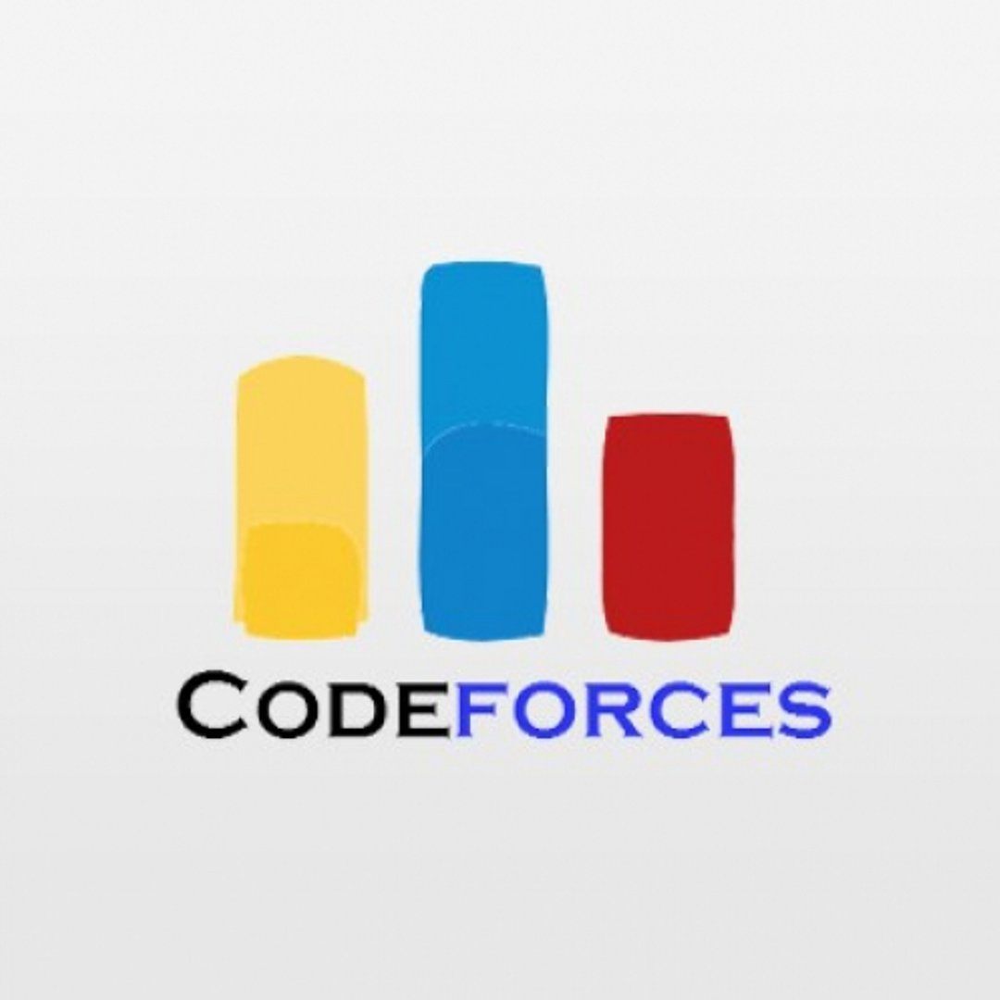

<h1 align="center">Hi 👋, I'm Tathagata Sur</h1>
<h3 align="center">A passionate competitive programmer and web developer from India</h3>

- Ask me about **Java, Python, C/C++, Next.js/Node.js, Advanced DSA, OS, CN, CoA & AI technologies**
- How to reach me **tathagatasur94@gmail.com**

## 🌐 Connect with me:

  
  
  
  
  

## 💻 Languages and Tools:
 
 
 
 

 
 

<!-- 
 
 -->

  
  

